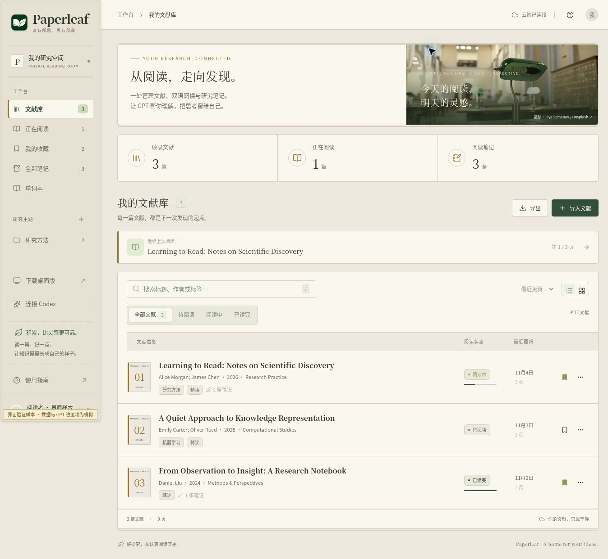
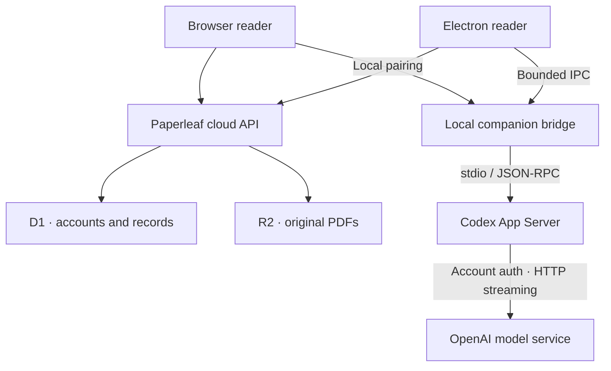

<p align="center">
  
</p>

# Paperleaf · Literature Workspace

**From an English PDF to understanding, lasting notes, and a research presentation.**

Paperleaf brings PDF reading, bilingual translation, research notes, vocabulary, and GPT conversations into one workspace. The web app stores your library in the cloud. The Windows client bundles Codex and uses official account authorization for model requests.

[Open the web app](https://paperleaf-xcz-reader.shamboo2003.chatgpt.site/) · [Download Windows EXE](https://github.com/XCZchaos/paperleaf-reader/releases/download/v1.4.2/Paperleaf-Setup-1.4.2-Windows-x64.exe) · [Latest release](https://github.com/XCZchaos/paperleaf-reader/releases/latest) · [简体中文](README.md)

| Current version | Desktop platform | Interface | Status |
| --- | --- | --- | --- |
| **1.4.2** | Windows 10 / 11 · x64 | shadcn/ui · paper-and-ink design · dark theme | Public source, actively iterated; desktop preview |

The application interface is primarily Chinese. Paperleaf is an independent application, not an official OpenAI product. Model access and usage limits depend on the signed-in Codex account.

## 1.4.2 · PDF annotations and contextual conversations

This release provides a new **1.4.2 Windows EXE installer**, the updated hosted reading workspace, and the in-app update feed. Close the previous app before installing, or use the desktop update panel. Existing accounts and cloud records are retained.

- Pan the PDF with the hand tool or Space + drag. **Ctrl / ⌘ + wheel** zooms around the pointer within the reading area (50%–250%). Text selection remains a separate tool.
- Draw on PDF pages or place movable, resizable text boxes. Ink colors/widths, erasing, undo/redo and JSON export are included. Annotations use normalized page coordinates and sync to the owner's cloud account. They are stored separately; downloading the original PDF does not embed them.
- Notes have more whitespace, a larger editor, readable cards, collapsible excerpts, keyword/page search and sorting.
- Follow up directly on drafts, saved notes, selected translations, translation history and full-text paragraphs. Each source has saved conversations carrying the original text, note/translation and page context. Long sources are explicitly excerpted.
- Body-first translation restores two-column order and paragraph indentation, repairs line-end hyphens, and filters detected front matter, repeated margins and references. An all-text alternative and legacy translations remain separately accessible. Complex layouts may still need review; scans require OCR.

See the [1.4.2 release notes](docs/releases/v1.4.2.md) and [reading-workspace verification record](docs/releases/web-2026-11-05.md).

## Preview



*UI verification screenshot using fictional papers and sample records, not user data. The reader, GPT output, import dialogs, and account screens share the same design system.*

**Navigate:** [Features](#features) · [Get started](#getting-started) · [Reading workflow](#reading-workflow) · [Architecture and data](#architecture) · [Development](#development) · [Verification](#verification) · [FAQ](#faq)

<a id="features"></a>

## Features

| Area | Implemented capabilities | Codex required? |
| --- | --- | --- |
| Library | Batch PDF import, duplicate detection, collections, tags, favorites, reading status, list / grid views | No for plain import |
| Metadata | Extract title, authors, year, venue, DOI, abstract, and keywords from the first three pages; generated filenames, retained original filenames, corrections and re-identification | Yes |
| PDF reader | Continuous vertical scrolling or horizontal pagination, outlines, search, zoom, page navigation, selection, highlights, excerpts, and saved progress | No |
| Translation | Selected text, opt-in automatic selection translation, continuous selection queues, paragraph-by-paragraph full-paper translation, pause / resume, and retry | For generation |
| Notes | Markdown editing and rendering, source-page links, bilingual notes, draft persistence, and export | No for manual notes |
| Vocabulary | GPT word detection, definitions, part of speech, context, examples, related words; automatic / manual collection, deduplication, mastery state, search, and export | For identification and definitions |
| Paper Q&A | Selected quotations, page ranges, follow-up questions, separate conversations, cloud history, and PDF page references | For generation |
| Summaries | Organize the problem, methods, experiments, contributions, and limitations from a page, range, or whole paper | Yes |
| Presentations | Generate 6 / 8 / 10 / 12 slides, edit the preview, and export a real PPTX with editable text, speaker notes, and source pages | For content generation |
| Desktop and sync | Cloud records, resizable panels, light / dark themes, update checks, release notes, and verified installer downloads | No |

Saved translations, notes, vocabulary, and GPT results remain readable after cloud sign-in without another model request.

### Three translation modes

| Mode | Interaction | Best suited to |
| --- | --- | --- |
| Selection / automatic selection | Select text and translate, or explicitly enable automatic translation | Unfamiliar words and difficult sentences |
| Continuous selection | Add passages to a sequential queue, with pause after the current passage | Close reading of selected sections |
| Full-paper bilingual view | Extract text by page and translate it paragraph by paragraph | Reading an entire English paper |

Full-paper translation saves each paragraph, resumes unfinished work, retries failed paragraphs, links back to source pages, and exports completed English / Chinese pairs. A failed save can be retried without regenerating the same translation. See the [FAQ](#faq) for scanned PDFs and complex layouts.

<a id="getting-started"></a>

## Get started

### Web or desktop?

| | Web app | Windows desktop |
| --- | --- | --- |
| Access | Open the website | Install the EXE and launch from Desktop / Start |
| Library and records | Shared cloud data after sign-in | The same cloud data after sign-in |
| GPT | Requires the optional companion on the same computer and browser pairing | Bundled Codex with an official browser authorization flow |
| Dependencies for users | No installation for basic reading; companion requires Node.js | No separate Node.js or command-line setup |
| Available delivery | Hosted website | Windows 10 / 11 x64 installer |

**Use the desktop client for the simplest GPT setup.** Advanced browser setup is documented in the [companion guide](companion/README.md). There are currently no official Paperleaf macOS / Linux desktop installers. Companion launch options for those systems do not constitute desktop releases.

### First launch on Windows

1. Download [Paperleaf-Setup-1.4.2-Windows-x64.exe](https://github.com/XCZchaos/paperleaf-reader/releases/download/v1.4.2/Paperleaf-Setup-1.4.2-Windows-x64.exe) and run the installer. It is approximately **200.7 MiB**; no ZIP extraction is needed.
2. Open Paperleaf, verify your website identity through ChatGPT, then register or sign in to Paperleaf. Use an independent Paperleaf password and keep the recovery code, which is displayed only once.
3. Open the Codex connection panel and choose “使用 ChatGPT 登录”. Complete official authorization in the system browser, then return to the reader.
4. Run “测试 GPT” to verify a real reply. This uses a small amount of account quota and reports first output, total duration, and retries.
5. Import a PDF, review the extracted title and authors, and begin reading.

Use the desktop “检查更新与版本说明” menu to read changes, download an update, verify it, and quit to install. You may also close the old client and manually run the new installer. **Clients on 1.1.x need a one-time manual upgrade. Fully quit and reopen after updating native connection code.**

Installation and uninstallation preserve local account directories and cloud records. The current installer is unsigned. See the [Windows guide](desktop/README.md).

### Understanding the sign-in steps

| Identity / account | Responsibility | On a new computer |
| --- | --- | --- |
| ChatGPT website identity | Trusted identity for cloud APIs and data ownership | Use the same website identity |
| Paperleaf account | Independent username, password, recovery code, and cloud sessions | Sign in to the existing Paperleaf account |
| Codex authorization | Access to the account's available GPT models and quota | Complete official authorization again |

A Paperleaf password is not a ChatGPT password. Codex credentials stay on the computer and are not uploaded with PDFs or notes. Signing out of Paperleaf, signing out of Codex, and unpairing a browser affect different sessions.

<a id="reading-workflow"></a>

## A reading-to-presentation workflow

1. **Organize a paper.** Create a collection and import the PDF. Review GPT metadata when smart import is enabled; plain import retains the original filename. The limit is **40 MB per PDF**.
2. **Keep evidence while reading.** Choose continuous scrolling or horizontal pagination, resize the side panel, and save highlights, excerpts, or notes linked to source pages.
3. **Translate and ask follow-ups.** Quote a difficult passage, ask about its terminology or assumptions, and continue the conversation. Use bilingual full-paper translation for a complete read, and retain unfamiliar words with their paper context.
4. **Develop a research summary.** Select the relevant pages, organize the question, method, experiments, and limitations, and verify the answer against the original.
5. **Prepare a lab meeting.** Choose a slide count, generate structured content, edit the preview, and export the PPTX for further editing in PowerPoint or WPS.

### Choosing models and reasoning effort

Suggestions are task-specific and filtered to **models and reasoning levels actually advertised by the signed-in account**. Translation, metadata, Q&A, summaries, and slides have separate preferences.

| Task | Starting point |
| --- | --- |
| Words, short passages, bibliographic metadata | An available lightweight model with lower reasoning effort |
| Everyday questions, standard summaries, presentation structure | An available balanced model with medium effort |
| Difficult derivations, evidence across passages, methodological limitations | An available stronger reasoning model with higher effort |

These are recommendations, not latency guarantees. More effort, longer context, and complex questions can increase waiting time and usage. Progress displays actual stages, public commentary, plans, retries, and public reasoning summaries when provided. Missing summaries are not fabricated; private internal reasoning is not displayed.

<a id="architecture"></a>

## Architecture and data flow



The desktop client loads the same HTTPS website and runs bundled Codex locally. Cloud APIs store library records; the local bridge submits bounded reading tasks. Version 1.4.1 defaults to an HTTP streaming compatibility connection and does not silently switch to metered API-key billing.

| Data | Storage / destination |
| --- | --- |
| Original PDF files | Owner-authorized cloud R2 storage |
| Metadata, collections, notes, highlights, progress, translations, words, and conversations | Owner-scoped cloud D1 database |
| Paper text, questions, and bounded conversation context sent to GPT | OpenAI model service through local Codex |
| Codex authorization | An isolated local profile; desktop profiles are scoped to Paperleaf users |
| Some drafts and translation sessions awaiting cloud save | Temporary device-local state, followed by save retry |
| Reading mode, panel widths, theme, and model preferences | Current device |

The website entry and source repository are public; website editing remains owner-only. Personal data APIs still require the matching identity and Paperleaf session. The app requires connectivity and does not provide full offline PDF reading or collaborative merging. Concurrent edits to the same draft / translation session use the last successful write.

<details>
<summary>Account and local-bridge implementation boundaries</summary>

- Passwords use random salts, a server-side pepper, HMAC-SHA256, and 100,000 PBKDF2-SHA256 iterations. Session and recovery tokens are random; only token digests are stored in the database.
- Session cookies use `Secure`, `HttpOnly`, `SameSite=Lax`, and the `__Host-` prefix. Repeated failed login / recovery attempts are throttled. Password changes and recovery revoke prior sessions and rotate the recovery code.
- `PAPERLEAF_PASSWORD_PEPPER` is a deployment secret, absent from this repository. Do not replace its production value without an account-credential migration plan.
- The browser companion binds loopback only and checks exact Origin, Host, and a random per-launch pairing token. Desktop bridge tokens are not exposed to the renderer.
- The bridge exposes bounded reading operations, not arbitrary RPC, files, or commands. Reading threads use restricted read-only permissions, tools and tool network access are disabled, and approval requests are refused.
- Conversation history persists in the cloud, but only bounded recent context is sent with each request. Older messages remain visible without necessarily being resent. Paper context is limited to 160,000 characters per request; use page ranges for longer material.
- Answers do not execute raw HTML or fetch model-provided remote images. Progress history does not retain raw upstream logs, credentials, or local paths.

</details>

## Stack and repository map

| Layer | Implementation |
| --- | --- |
| Interface | React 19, TypeScript, shadcn/ui, Tailwind CSS, Lucide |
| Reading and typesetting | PDF.js, react-markdown, remark-gfm, KaTeX |
| Web runtime | Vinext / Vite, Cloudflare Workers |
| Data and storage | D1, R2, Drizzle ORM, SQL migrations |
| Desktop | Electron 45.2.2, Preload / IPC, NSIS installer |
| GPT integration | Official Codex 0.165.0, App Server, stdio / JSON-RPC |
| Presentation export | PptxGenJS: editable text, notes, and source-page references |

See [package.json](package.json) and the lockfile for dependencies, and [desktop/release.json](desktop/release.json) for desktop release metadata.

| Path | Responsibility |
| --- | --- |
| [app/](app/) | Library, reader, translation, vocabulary, account UI, and server APIs |
| [components/ui/](components/ui/) | shadcn/ui components |
| [lib/](lib/) | Sessions, client APIs, conversation context, model advice, PPTX, and cloud persistence |
| [companion/](companion/) | Local HTTP bridge, Codex protocol, task progress, and optional launchers |
| [desktop/](desktop/) | Electron main process, Preload, Codex lifecycle, updater, and installer configuration |
| [db/](db/) / [drizzle/](drizzle/) | Schema and database migrations |
| [worker/](worker/) | Cloudflare Worker entry |
| [public/](public/) | PDF.js resources, brand assets, guide, and browser companion download |
| [scripts/](scripts/) | Build, packaging, installation checks, and model tests |
| [docs/releases/](docs/releases/) | Release-specific notes |

<a id="development"></a>

## Development and builds

### Prerequisites

Use **Node.js ≥ 22.13.0** and **pnpm 11.25.0**. Install from the lockfile and preserve the existing Sites / Vite integration.

```bash
git clone https://github.com/XCZchaos/paperleaf-reader.git
cd paperleaf-reader
pnpm install --frozen-lockfile
```

This is not a static-only website. Full account and library functionality requires:

| Configuration | Purpose |
| --- | --- |
| D1 binding `DB` | Initialize and apply the SQL migrations in `drizzle/` in order |
| R2 binding `BUCKET` | Store and retrieve PDFs |
| `PAPERLEAF_PASSWORD_PEPPER` | A separate random development secret, configurable through the local Worker's `.dev.vars` |
| Trusted website identity | Production uses Sites identity; local loopback development has a mock identity that must not be exposed as public authentication |

Once those requirements are prepared:

```bash
pnpm dev
# Static type checking
pnpm exec tsc --noEmit
# Build the web application; this does not publish production
pnpm build
```

There is currently no one-command self-hosting installer. Cloning and starting a development server does not configure database state, secrets, or production authentication. Keep local data separate from production. Add migrations for schema changes rather than editing already-applied SQL files.

### Building the Windows client

The current scripts package Windows x64 from a Linux build environment. They require system `tar` and access to official Electron, Codex, and build-tool downloads.

```bash
node scripts/build-desktop.mjs
node scripts/check-desktop.mjs
node scripts/build-installer.mjs
```

| Output | Location |
| --- | --- |
| Application directory | `work/desktop/release/Paperleaf-win32-x64/` |
| EXE installer | `work/desktop/installer/` |
| Version, download URL, and SHA-256 | `desktop/release.json` |

The installer uses solid LZMA compression and retains English / Chinese Chromium locales plus the required official Codex resources and licenses. The build enforces a **245 MiB** installer budget. Updates currently download the full installer, not a differential patch.

After modifying `companion/`, run `node scripts/package-companion.mjs` to refresh the browser companion. Verify the final EXE version and SHA-256 before updating release metadata. After the web build, `node scripts/package-desktop-updates.mjs` creates same-origin update chunks. Generated binaries are delivered through Releases / the Site rather than committed to source Git.

### Deployment

The existing production website is hosted by Sites. GitHub manages source and releases; **pushing to GitHub does not automatically deploy the website**. Web publication requires the corresponding Sites source state, a matching build artifact, and a saved/deployed version.

`.openai/hosting.json` is associated with the existing Site. An independent deployment needs its own trusted identity, D1 / R2 resources, migrations, and runtime secrets, plus matching desktop site URLs and exact Origin allowlists. This project cannot be deployed directly as static GitHub Pages; do not remove identity checks to make it run elsewhere.

<a id="verification"></a>

## Verification

Run these commands from a complete checkout with dependencies installed. Offline checks, live inference, and released-installer checks have different scopes; version-specific evidence is listed below.

| Check | Command |
| --- | --- |
| TypeScript | `pnpm exec tsc --noEmit` |
| Accounts, owner isolation, persistence, and recovery | `node --experimental-vm-modules scripts/check-api.mjs` |
| Transport and retry classification | `node scripts/check-transport.mjs` |
| Bridge, task lifecycle, and progress | `node scripts/check-companion.mjs` |
| Real pinned Codex session protocol | `node scripts/check-codex-protocol.mjs` |
| Markdown rendering and safety boundaries | `node scripts/check-markdown.mjs` |
| Reading, conversation context, paragraphs, and model advice | `node scripts/check-reading.mjs` |
| PPTX export structure | `node scripts/check-pptx.mjs` |
| Update verification and lifecycle | `node scripts/check-updater.mjs` |
| Packaged desktop structure and icons | `node scripts/check-desktop.mjs` (build desktop first) |

**Live model checks are separate, optional, and consume account quota:**

```bash
node scripts/check-codex-live.mjs --profile /absolute/path/to/already-signed-in-profile
node scripts/check-vocabulary-live.mjs --profile /absolute/path/to/already-signed-in-profile
```

Use an already-authorized Codex profile that you are entitled to access. Where supported by the test, select a model and effort available to that account. Never commit credentials, recovery codes, pairing tokens, or `.dev.vars`. An unauthenticated protocol check is not a real inference test.

**Published 1.4.1 evidence:**

- [Windows Codex compatibility](https://github.com/XCZchaos/paperleaf-reader/actions/runs/41819224194): passed.
- [Released EXE installation on Windows](https://github.com/XCZchaos/paperleaf-reader/actions/runs/41819560078): passed download / SHA-256 verification, installed version, shortcut icons, installed Codex session creation, and desktop process startup.
- On 2026-11-04, eight real `gpt-6.1-terra / low` requests completed on short synthetic material, covering questions, follow-ups, translation, metadata, summary, and a six-slide report. All had zero retries, with first output in approximately 1.50–2.47 seconds.
- The original retry issue was not reproduced on that network; the results do not predict long-paper or other-network performance. Usage refresh still returned HTTP 401 for the test account. Interactive Windows OAuth and user-specific networking remain outside automation. See [1.4.1 verification boundaries](docs/releases/v1.4.1.md).

<a id="faq"></a>

## FAQ

| Question | Answer |
| --- | --- |
| Can I use Paperleaf without Codex? | Yes: plain import, reading, manual notes, and previously saved results remain available after cloud sign-in. Smart metadata, translation, Q&A, and content generation require Codex. |
| Does sign-in provide unlimited GPT access? | No. Available models, reasoning levels, and quota depend on the account. Paperleaf does not automatically switch to a billed API key. |
| Why can requests still retry? | Network, proxy, service, rate-limit, or authorization problems can affect requests. Version 1.4.1 uses HTTP streaming and classifies reported causes. Upgrade, restart, then run “测试 GPT”. Unknown causes remain unknown; zero retries are not guaranteed. |
| Why can quota refresh fail while Q&A works? | They use different requests. The test profile's refresh endpoint returns HTTP 401. Errors and stale-data warnings remain visible; cached values are not reported as a successful refresh. |
| Why is there no reasoning summary? | It is displayed only when Codex returns a public summary. Some models / tasks provide none; real stage and public progress events remain available. |
| Does it understand scans and figures? | It primarily extracts PDF text layers. It has no built-in OCR and does not provide full image, figure, or formula-image understanding. OCR scans first and verify complex column order. |
| Why use page ranges for long papers? | Paper context is capped at 160,000 characters per request; conversations send bounded recent context. Smaller ranges also make evidence easier to inspect. |
| Does retrying a save spend more quota? | Use the existing result's save-retry action. Explicit regeneration / retranslation starts another corresponding model task. |
| Why are my records missing on another device? | Check that both the ChatGPT website identity and Paperleaf account match. Codex must be authorized separately on the new machine. |
| Can my phone use Codex running on my computer? | There is no remote Codex relay. The optional bridge binds the local loopback interface and cannot be accessed directly from another device. |
| Why is the installer still about 201 MiB? | It includes Electron / Chromium and the official native Codex runtime. Compression and locale trimming reduce size while retaining required resources. |

## Release history

| Version | Highlights |
| --- | --- |
| [1.4.2](docs/releases/v1.4.2.md) | PDF panning/zoom, pen/text annotations, spacious notes, contextual follow-ups, body-first translation |
| [1.4.1](docs/releases/v1.4.1.md) | Archive-inspired UI, HTTP streaming compatibility, real retry classification, connection timings |
| [1.4.0](docs/releases/v1.4.0.md) | shadcn/ui, follow-up conversations, full-paper bilingual translation, vocabulary, task-specific model advice |
| [1.3.0](docs/releases/v1.3.0.md) | Markdown / math, resizable panels, public progress, reasoning effort, and usage UI |
| [1.2.0](docs/releases/v1.2.0.md) | Continuous reading, in-app updates, smaller installers, and Windows protocol compatibility |
| [1.1.1](docs/releases/v1.1.1.md) | Codex permission compatibility, PDF selection display, and an EXE installer |

Installers, checksums, and versioned source are available in [Releases](https://github.com/XCZchaos/paperleaf-reader/releases).

## Feedback and contributions

Use [Issues](https://github.com/XCZchaos/paperleaf-reader/issues) for bugs and feature suggestions. Include the app version, operating system, reproduction steps, expected / actual behavior, and sanitized errors. Connection reports can include the model, durations, retry count, and category from “测试 GPT”. For layout issues, prefer a public paper or a minimal document you are allowed to share.

An Issue describing the scope is helpful before a substantial change. Run checks relevant to reader, account, bridge, or packaging changes; add migrations for schema changes; and distinguish simulated UI data from real model results. Include screenshots for interface changes without personal documents or credentials.

## Assets and licensing

See [ASSET-CREDITS.md](public/ASSET-CREDITS.md) for brand assets and photography. Third-party licenses remain in the relevant source directories and release packages. Electron, Chromium, Codex, PDF.js, and other dependencies retain their respective licenses.

**This repository does not currently specify a project-level open-source license.** A dependency's license does not establish the license of Paperleaf as a whole.
