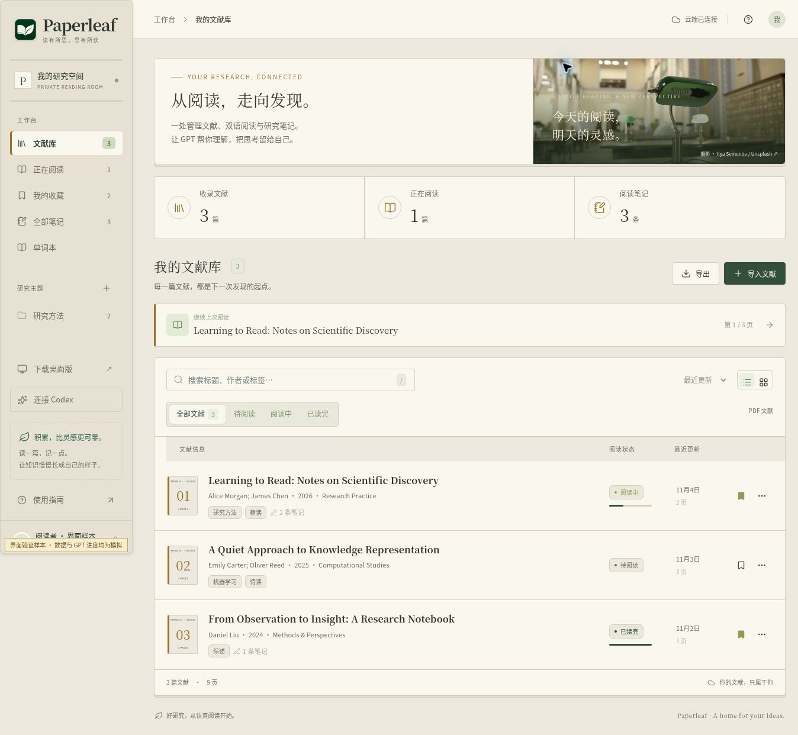
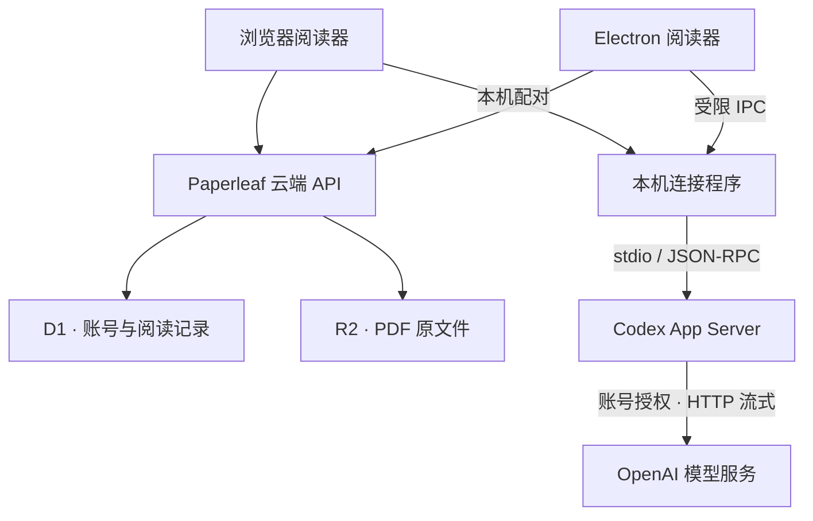

<p align="center">
  
</p>

# Paperleaf · 文献阅读工作台

**从一篇英文 PDF，到读懂、记住，再到讲清楚。**

Paperleaf 将文献管理、PDF 阅读、中英对照、研究笔记、单词积累和 GPT 问答放在同一张工作台上。网页版保存你的阅读资料，Windows 桌面版内置 Codex，通过官方账号授权调用 GPT，帮助你从日常精读走到组会汇报。

[打开网页版](https://paperleaf-xcz-reader.shamboo2003.chatgpt.site/) · [下载 Windows EXE](https://github.com/XCZchaos/paperleaf-reader/releases/download/v1.4.1/Paperleaf-Setup-1.4.1-Windows-x64.exe) · [最新发行版](https://github.com/XCZchaos/paperleaf-reader/releases/latest) · [English](README.en.md)

| 当前版本 | 桌面平台 | 界面 | 项目状态 |
| --- | --- | --- | --- |
| **1.4.1** | Windows 10 / 11 · x64 | shadcn/ui · 复古纸页 · 夜读主题 | 公开源码，持续迭代；桌面预览版 |

Paperleaf 是独立开发的应用，并非 OpenAI 官方产品。模型访问与额度取决于你已登录的 Codex 账号。

## 界面预览



*界面验证截图，使用虚构文献与示例记录，不包含用户资料。阅读器、GPT 回答、导入和账号页面使用同一套设计语言。*

**快速导航：** [功能](#features) · [开始使用](#getting-started) · [阅读流程](#reading-workflow) · [架构与数据](#architecture) · [开发与构建](#development) · [验证](#verification) · [常见问题](#faq)

<a id="features"></a>

## 你可以用它做什么

| 模块 | 已实现的能力 | 是否需要 Codex |
| --- | --- | --- |
| 文献库 | 批量导入 PDF、重复文件检测、主题分类、标签、收藏、阅读状态、列表 / 卡片视图 | 普通导入不需要 |
| 智能整理 | 从前 3 页识别标题、作者、年份、期刊 / 会议、DOI、摘要与关键词；生成文件名，保留原文件名，支持校正与重新识别 | 需要 |
| PDF 阅读器 | 竖向连续滚动 / 横向翻页、目录、搜索、缩放、跳页、文字选择、高亮、摘录、进度恢复 | 不需要 |
| 翻译 | 划词翻译、可选自动划译、连续选择翻译、全文逐段中英对照、暂停继续、单段失败重试 | 生成译文时需要 |
| 研究笔记 | Markdown 编辑与排版、来源页定位、双语笔记、草稿保存与导出 | 手写笔记不需要 |
| 单词本 | GPT 判断单词并整理释义、词性、语境、例句、相关词；自动 / 手动收录、去重、掌握标记、搜索与导出 | 识别与生成释义时需要 |
| 文献问答 | 引用选中文本、指定页码提问、连续追问、多个独立对话、云端历史、原文页码引用 | 生成回答时需要 |
| 精读总结 | 按当前页、页码范围或全文整理问题、方法、实验、贡献与局限 | 需要 |
| 汇报 PPT | 生成 6 / 8 / 10 / 12 页内容，预览编辑后导出可编辑 PPTX，包含讲稿备注和来源页码 | 生成内容时需要 |
| 桌面与同步 | 云端资料同步、可拖动侧栏、浅色 / 深色主题、版本检查、更新说明、校验后安装 | 不需要 |

已保存的译文、笔记、单词与 GPT 成果，在登录云端账号后可以查看，不需要为了查看再次调用 GPT。

### 三种翻译方式

| 方式 | 操作 | 适合的阅读习惯 |
| --- | --- | --- |
| 划词 / 自动划译 | 选中文本后点击翻译，或主动开启“自动划译” | 遇到生词或难句时即时理解 |
| 连续翻译 | 连续选中多个段落，依次加入队列；可在完成当前段后暂停 | 只精读论文中的重点部分 |
| 全文中英对照 | 按页提取文字、按段翻译，逐段显示英文与中文 | 需要系统阅读整篇英文论文 |

全文翻译逐段保存，支持继续未完成任务、重试失败段落、返回原文页和导出已完成的中英对照。保存失败时可以只重试保存，避免再次生成同一份译文。复杂双栏、公式和扫描页的边界见[常见问题](#faq)。

<a id="getting-started"></a>

## 开始使用

### 选择网页版还是桌面版

| | 网页版 | Windows 桌面版 |
| --- | --- | --- |
| 打开方式 | 浏览器访问网站 | 安装 EXE 后从桌面 / 开始菜单打开 |
| 文献、笔记和记录 | 登录后使用同一套云端资料 | 登录后使用同一套云端资料 |
| GPT 功能 | 需在同一电脑运行可选的本机连接程序，并完成配对 | 已内置 Codex，直接打开官方授权页登录 |
| 运行依赖 | 基础阅读无需安装；本机连接程序需要 Node.js | 普通用户无需安装 Node.js 或运行命令 |
| 当前交付 | 在线网站 | Windows 10 / 11 x64 安装包 |

**希望直接登录并使用 GPT，优先使用桌面版。** 浏览器连接方式见[本机连接程序说明](companion/README.md)。macOS / Linux 当前没有正式桌面安装包；可选连接程序提供对应启动方式，但不代表已有这些系统的桌面发行版。

### Windows 首次使用

1. 下载 [Paperleaf-Setup-1.4.1-Windows-x64.exe](https://github.com/XCZchaos/paperleaf-reader/releases/download/v1.4.1/Paperleaf-Setup-1.4.1-Windows-x64.exe)，双击安装。安装包约 **200.8 MiB**，无需解压 ZIP。
2. 打开 Paperleaf，先通过 ChatGPT 验证网站访问身份，再注册或登录 Paperleaf 账号。为 Paperleaf 设置独立密码，并保存只显示一次的恢复码。
3. 打开“连接 Codex”，点击“使用 ChatGPT 登录”，在系统浏览器完成官方授权，返回阅读器。
4. 点击“测试 GPT”，确认能够收到真实回复；此操作会消耗少量账号额度，并显示首次输出耗时、总耗时和重试次数。
5. 导入 PDF，核对 GPT 识别出的标题与作者，开始阅读。

升级时可使用桌面菜单的“检查更新与版本说明”，查看变更、下载并校验后选择“退出并安装”。也可以关闭旧版后手动安装新版。**1.1.x 首次升级需要手动安装；更新连接代码后必须完整退出并重新打开应用。**

安装与卸载会保留原本机账号目录及云端资料。当前安装包尚未代码签名，详细说明见 [Windows 使用指南](desktop/README.md)。

### 为什么有多个登录步骤

| 身份 / 账号 | 负责什么 | 换电脑时 |
| --- | --- | --- |
| ChatGPT 网站访问身份 | 为云端接口提供可信身份，确定资料所属用户 | 使用相同的访问身份 |
| Paperleaf 账号 | 独立用户名、密码、恢复码与云端会话 | 登录原有 Paperleaf 账号 |
| Codex 授权 | 使用该账号可用的 GPT 模型与额度 | 在新电脑重新完成官方授权 |

Paperleaf 密码不是 ChatGPT 密码。Codex 授权保留在本机，不随 PDF 或笔记上传。退出 Paperleaf、退出 Codex 和断开浏览器配对分别对应不同的会话操作。

<a id="reading-workflow"></a>

## 从导入到汇报

1. **归档文献。** 新建研究主题，导入 PDF。启用智能识别后检查元信息；关闭智能识别则按原文件名普通导入。单个 PDF 上限为 **40 MB**。
2. **阅读并留下依据。** 选择横向翻页或竖向连续阅读，调整侧栏宽度；遇到重点内容时高亮、摘录或添加带来源页码的笔记。
3. **翻译与追问。** 选中难句交给 GPT 解释，继续追问术语、假设或方法；需要通读时开启逐段中英对照。单词可收进单词本，保留所在文献的语境。
4. **整理研究判断。** 指定阅读页码，让 GPT 梳理研究问题、方法、实验和局限，结合原文核对回答与引用。
5. **准备组会汇报。** 选择 PPT 页数，生成结构化内容，修改预览中的文字，再导出 PPTX 到 PowerPoint / WPS 继续编辑。

### 模型和思考强度怎么选

应用按具体任务提供建议，并过滤成**当前账号实际可用的模型及其支持的思考档位**。翻译、识别、问答、总结和汇报可以分别保存偏好。

| 任务 | 建议起点 |
| --- | --- |
| 单词、短句、书目信息识别 | 可用的轻量模型 + 较低思考强度 |
| 日常文献问答、常规总结、汇报结构 | 可用的均衡模型 + 中等思考强度 |
| 复杂推导、跨段证据比较、方法局限分析 | 可用的较强推理模型 + 较高思考强度 |

这些是选择建议，不是响应速度保证。高思考强度、较长上下文和复杂问题都可能增加等待与用量。进度区展示实际收到的阶段、公开进展、计划、重试，以及模型提供的公开思考摘要；没有摘要时不会编造内容，也不展示原始内部推理。

<a id="architecture"></a>

## 架构与数据流



桌面版加载同一个 HTTPS 网站，并在本机运行内置 Codex。云端负责资料与记录，本机连接程序负责向 Codex 提交限定的阅读任务。1.4.1 默认采用 HTTP 流式兼容连接；不会自动切换为 API Key 按量计费。

| 数据 | 保存位置 / 流向 |
| --- | --- |
| PDF 原文件 | 按用户授权的云端 R2 对象存储 |
| 元信息、主题、笔记、高亮、进度、译文、单词和对话 | 按用户隔离的云端 D1 数据库 |
| 提交给 GPT 的文献文字、问题与有限对话上下文 | 经本机 Codex 发送至 OpenAI 模型服务 |
| Codex 登录授权 | 本机独立配置；桌面版按 Paperleaf 用户隔离 |
| 网络失败时部分待同步的草稿与翻译会话 | 当前设备暂存，随后重试保存 |
| 阅读方式、侧栏尺寸、主题和模型偏好 | 当前设备 |

网站入口与源码仓库公开，网站编辑权限仅归站点所有者。个人资料接口仍需要对应的身份与 Paperleaf 会话。客户端需要联网；当前不提供完整离线 PDF 阅读或多人实时合并，同一份草稿 / 翻译会话的并发编辑以最后成功保存为准。

<details>
<summary>账号与本机连接的实现边界</summary>

- 密码使用随机盐、服务端 pepper、HMAC-SHA256 和 100,000 次 PBKDF2-SHA256；会话与恢复令牌为随机值，数据库只保存令牌摘要。
- 会话 Cookie 使用 `Secure`、`HttpOnly`、`SameSite=Lax` 和 `__Host-` 前缀。登录 / 恢复连续失败会触发限流；修改密码或使用恢复码会撤销旧会话并更新恢复码。
- `PAPERLEAF_PASSWORD_PEPPER` 是部署环境密钥，不包含在仓库中；不要在没有账号迁移方案时替换生产值。
- 浏览器连接程序仅监听回环地址，校验 Origin、Host 与每次启动的随机配对码。桌面版的本机桥接令牌不暴露给页面。
- 只开放限定的阅读操作，不开放通用 RPC 或任意文件 / 命令接口。阅读线程使用受限只读权限，工具与工具网络访问关闭，审批请求拒绝。
- 普通问答保留云端历史，但每次只发送有限的近期上下文；旧消息仍可查看，不代表每次都会全部发送。单次文献上下文最多 16 万字符，超长内容应指定页码。
- 原始 HTML 和模型给出的远程图片不会在回答中执行或加载。诊断记录不会直接写入原始上游日志、凭据或本机路径。

</details>

## 技术栈与目录

| 层次 | 实现 |
| --- | --- |
| 界面 | React 19、TypeScript、shadcn/ui、Tailwind CSS、Lucide |
| 阅读与排版 | PDF.js、react-markdown、remark-gfm、KaTeX |
| Web 运行时 | Vinext / Vite、Cloudflare Workers |
| 数据与存储 | D1、R2、Drizzle ORM 与 SQL 迁移 |
| 桌面端 | Electron 45.2.2、Preload / IPC、NSIS 安装包 |
| GPT 接入 | 官方 Codex 0.165.0、App Server、stdio / JSON-RPC |
| 汇报导出 | PptxGenJS，可编辑文字、备注和页码引用 |

具体依赖以 [package.json](package.json) 和锁文件为准，桌面版本信息见 [desktop/release.json](desktop/release.json)。

| 路径 | 用途 |
| --- | --- |
| [app/](app/) | 文献库、阅读器、翻译、单词本、账号界面与服务端 API |
| [components/ui/](components/ui/) | shadcn/ui 组件 |
| [lib/](lib/) | 账号会话、客户端接口、上下文整理、模型建议、PPTX 与云端同步 |
| [companion/](companion/) | 本机 HTTP 桥接、Codex 协议、任务进度与可选启动器 |
| [desktop/](desktop/) | Electron 主进程、Preload、Codex 生命周期、更新器与安装配置 |
| [db/](db/) / [drizzle/](drizzle/) | 数据结构与数据库迁移 |
| [worker/](worker/) | Cloudflare Worker 入口 |
| [public/](public/) | PDF.js 资源、品牌图标、指南与浏览器连接程序 |
| [scripts/](scripts/) | 构建、打包、安装验证与模型测试 |
| [docs/releases/](docs/releases/) | 按版本记录的更新说明 |

<a id="development"></a>

## 开发与构建

### 环境准备

需要 **Node.js ≥ 22.13.0** 和 **pnpm 11.25.0**。建议从锁文件安装，保留现有 Sites / Vite 集成。

```bash
git clone https://github.com/XCZchaos/paperleaf-reader.git
cd paperleaf-reader
pnpm install --frozen-lockfile
```

这不是纯静态网页项目。使用完整账号与资料功能前，需要准备：

| 配置 | 用途 |
| --- | --- |
| D1 绑定 `DB` | 初始化并按顺序应用 `drizzle/` 下的数据库迁移 |
| R2 绑定 `BUCKET` | 保存和读取 PDF |
| `PAPERLEAF_PASSWORD_PEPPER` | 为开发环境单独生成的随机账号密钥，可通过本地 Worker 的 `.dev.vars` 配置 |
| 可信网站身份入口 | 正式部署依赖 Sites 身份；本地回环开发提供模拟身份，不能将其用于公开服务 |

配置完成后：

```bash
pnpm dev
# 静态类型检查
pnpm exec tsc --noEmit
# Web 构建；本身不会发布生产站点
pnpm build
```

仓库目前没有一键自托管安装器。克隆代码和启动开发服务，不代表已经配置好数据库、账号密钥及生产身份入口；数据库本地状态与生产数据应分开。已有 SQL 迁移不要改写，结构变化应新增迁移。

### Windows 桌面构建

现有脚本在 Linux 构建环境打包 Windows x64，需系统 `tar`，并能下载官方 Electron、Codex 和构建工具。

```bash
node scripts/build-desktop.mjs
node scripts/check-desktop.mjs
node scripts/build-installer.mjs
```

| 输出 | 位置 |
| --- | --- |
| 程序目录 | `work/desktop/release/Paperleaf-win32-x64/` |
| EXE 安装包 | `work/desktop/installer/` |
| 版本、下载地址与 SHA-256 | `desktop/release.json` |

安装包采用 solid LZMA 压缩，保留中英文 Chromium 语言资源及官方 Codex 资源 / 许可证。构建设置 **245 MiB** 体积上限；当前更新仍下载完整安装包，尚非差分更新。

修改 `companion/` 后运行 `node scripts/package-companion.mjs`，同步更新浏览器连接程序。确认最终 EXE 的版本与 SHA-256 后更新发行元信息；Web 构建后运行 `node scripts/package-desktop-updates.mjs` 生成同源更新分块。二进制生成物通过 Releases / 站点发布，不提交进源码 Git。

### 部署说明

现有线上站点由 Sites 托管；GitHub 用于源码管理和版本发行。**向 GitHub push 不会自动更新线上网站。** 发布网页时需推送对应的 Sites 源码状态、构建匹配的产物，再保存并部署版本。

`.openai/hosting.json` 关联现有站点。独立部署需要自己的站点身份、D1 / R2、迁移及运行密钥，并相应配置桌面版的站点地址与精确 Origin 允许列表。不能直接把该项目作为静态 GitHub Pages 网站部署，也不应移除身份校验来适配其他平台。

<a id="verification"></a>

## 验证与质量检查

以下命令在完整安装依赖的源码目录运行。离线检查、真实模型调用和发布安装包检查的覆盖范围不同；版本验证记录见下方。

| 检查 | 命令 |
| --- | --- |
| TypeScript | `pnpm exec tsc --noEmit` |
| 账号、权限隔离、数据与恢复流程 | `node --experimental-vm-modules scripts/check-api.mjs` |
| 连接方式与重试原因分类 | `node scripts/check-transport.mjs` |
| 本机桥接、任务生命周期与进度 | `node scripts/check-companion.mjs` |
| 固定版本 Codex 的真实会话协议 | `node scripts/check-codex-protocol.mjs` |
| Markdown 排版与渲染边界 | `node scripts/check-markdown.mjs` |
| 阅读、对话上下文、段落与模型建议 | `node scripts/check-reading.mjs` |
| PPTX 导出结构 | `node scripts/check-pptx.mjs` |
| 桌面更新校验与流程 | `node scripts/check-updater.mjs` |
| 打包后的桌面结构与图标 | `node scripts/check-desktop.mjs`（先构建桌面端） |

**真实模型测试是独立的、可选的步骤，会消耗账号额度：**

```bash
node scripts/check-codex-live.mjs --profile /absolute/path/to/already-signed-in-profile
node scripts/check-vocabulary-live.mjs --profile /absolute/path/to/already-signed-in-profile
```

使用你有权使用、已经登录的 Codex 配置目录，按需传入当前账号支持的模型与思考强度；不要把凭据、恢复码、配对码或 `.dev.vars` 提交到仓库。无凭据的协议检查不等于真实 GPT 问答测试。

**1.4.1 已发布版本的证据：**

- [Windows Codex 兼容检查](https://github.com/XCZchaos/paperleaf-reader/actions/runs/41819224194)：通过。
- [发布 EXE 的 Windows 安装检查](https://github.com/XCZchaos/paperleaf-reader/actions/runs/41819560078)：通过下载与 SHA-256 校验、安装版本、快捷方式图标、内置 Codex 会话和桌面进程启动检查。
- 2026-11-04，真实 `gpt-6.1-terra / low` 完成 8 次短合成材料请求，覆盖问答、追问、翻译、元信息、总结与 6 页汇报，均零重试，首次输出约 1.50–2.47 秒。
- 原重试问题未在该网络复现；上述结果不代表长论文或其他网络的速度。额度刷新在测试账号仍返回 HTTP 401，Windows 交互式 OAuth 与个人网络配置不在自动化覆盖范围。详见 [1.4.1 验证范围](docs/releases/v1.4.1.md)。

<a id="faq"></a>

## 常见问题

| 问题 | 说明与处理 |
| --- | --- |
| 不登录 Codex 能用吗？ | 可以普通导入、阅读、手写笔记及查看已保存成果；访问个人资料仍需登录云端账号。智能识别、翻译、问答和内容生成需要 Codex。 |
| 登录后是否无限使用 GPT？ | 不是。模型、思考档位与额度以账号实际可用能力为准；程序不自动转为付费 API 调用。 |
| 为什么仍会重试？ | 网络、代理、服务端、限流或授权均可能影响请求。1.4.1 使用 HTTP 流式兼容连接并分类显示原因；先更新并重启，再运行“测试 GPT”。未知原因会明确标注，不保证零重试。 |
| 额度刷新失败，但问答正常？ | 两者是不同请求。测试账号的刷新接口存在 HTTP 401；界面保留失败与旧数据提示，旧数据显示不代表刷新成功。 |
| 没有显示思考摘要？ | 只有 Codex 实际返回公开摘要才显示。部分模型 / 任务不返回；可继续查看真实阶段与公开进度。 |
| 扫描 PDF 或图表能直接理解吗？ | 当前主要提取 PDF 文字层，不内置 OCR，也不等同于完整图像、图表或公式理解。扫描件请先 OCR；双栏段落顺序需要核对。 |
| 长文献为什么需要指定页码？ | 单次文献上下文限制为 16 万字符；对话只携带有限近期上下文。按章节或页码拆分有利于核对依据。 |
| 云端保存失败会重新消耗额度吗？ | 对已有生成结果使用“重试保存”；只有明确重新生成 / 重新翻译才再次发起对应模型任务。 |
| 换电脑后看不到原来的资料？ | 检查是否使用了相同的 ChatGPT 网站访问身份和 Paperleaf 账号；本机 Codex 授权需要重新完成。 |
| 能在手机上直接调用电脑里的 Codex 吗？ | 当前没有远程 Codex 中继；浏览器连接程序只监听本机回环地址，不能从另一台设备直接使用。 |
| 为什么安装包仍有约 201 MiB？ | 包含 Electron / Chromium 和官方 Codex 原生运行环境，方便无需命令行安装。已压缩并精简语言资源，未移除所需 Codex 组件。 |

## 版本记录

| 版本 | 重点 |
| --- | --- |
| [1.4.1](docs/releases/v1.4.1.md) | 复古界面、HTTP 流式兼容连接、真实重试分类、连接测速 |
| [1.4.0](docs/releases/v1.4.0.md) | shadcn/ui、连续追问、全文中英对照、单词本、分任务模型建议 |
| [1.3.0](docs/releases/v1.3.0.md) | Markdown / 公式排版、可调侧栏、公开进度、思考强度与额度界面 |
| [1.2.0](docs/releases/v1.2.0.md) | 竖向连续阅读、应用内更新、安装包压缩、Windows 协议兼容 |
| [1.1.1](docs/releases/v1.1.1.md) | Codex 权限适配、PDF 划词显示和 EXE 安装包 |

全部安装包、校验值与对应源码见 [Releases](https://github.com/XCZchaos/paperleaf-reader/releases)。

## 反馈与参与

欢迎通过 [Issues](https://github.com/XCZchaos/paperleaf-reader/issues) 反馈问题或提出改进建议。请尽量提供：应用版本、系统版本、复现步骤、预期 / 实际结果，以及已脱敏的报错。连接问题可附“测试 GPT”的模型、耗时、重试次数和分类；PDF 排版问题优先附公开论文或可分享的最小样本。

修改前可先提出 Issue 说明范围。涉及阅读器、账号、连接或打包的变更，请运行对应检查；新增数据库结构应追加迁移；涉及 GPT 的演示请区分模拟数据与真实调用结果。提交界面改动时附截图，不附个人文献或登录凭据。

## 素材与许可证

品牌素材与摄影说明见 [ASSET-CREDITS.md](public/ASSET-CREDITS.md)。第三方许可证保留在对应源码和发行包中，Electron、Chromium、Codex、PDF.js 等遵循各自许可证。

**当前仓库尚未指定项目级开源许可证。** 第三方组件的许可证不代表 Paperleaf 整体已使用相同许可证。

