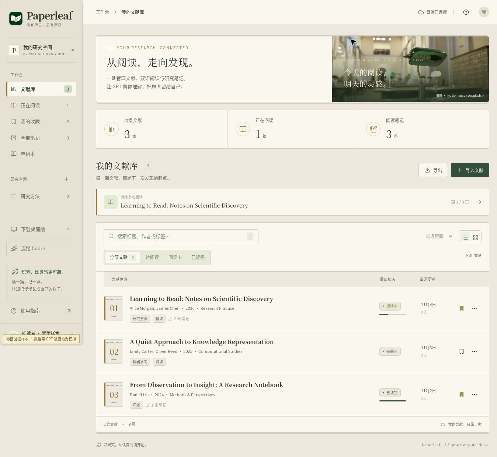

# Paperleaf v1.4.1

文献馆复古界面与 Codex 连接兼容性更新。

- 文献库、阅读器、GPT 回答、导入窗口与账号页面改用暖纸色、墨绿、衬线标题、细线与书目编号；保留夜读主题和 shadcn/ui 的键盘交互。
- 内置 Codex 默认使用 HTTP 流式连接，避免部分网络或代理下反复建立 WebSocket 的等待。仍通过 Codex 官方账号登录，使用账号可用额度；不转为 API Key 计费。
- 按 Codex 返回的信息区分服务错误、限流、授权、连接、响应中断、超时和请求问题。未知原因明确标注，不再全部称为“连接重试”。保留实际重试次数和时间。
- “连接 Codex → 测试 GPT”显示首次输出时间、总耗时和重试次数。旧连接程序会提示升级；网页刷新不会替换电脑内置的 Codex 连接代码。
- 重试沿用当前 Codex 任务，应用不额外发起完整的模型请求。诊断历史不包含原始上游日志、地址、凭据或本机路径。

## 安装与升级

下载 `Paperleaf-Setup-1.4.1-Windows-x64.exe`，关闭旧版后直接安装。也可在桌面菜单“检查更新与版本说明”中查看更新并安装。云端文献、笔记和本机账号目录保留。

## 验证与边界

2026-11-04，真实登录账号通过生产连接代码调用 `gpt-6.1-terra / low`：问答、带历史追问、段落翻译、普通翻译、元信息识别、总结、6 页 PPT，共 8 次请求全部完成，重试为 0；首次输出为 1.50–2.47 秒。均为简短合成材料，不代表长论文、其他模型或用户网络的耗时。默认连接在此测试环境也未复现用户的重试，不能据此断言根因或保证完全消除重试。

固定 Codex 0.165.0 的真实协议检查覆盖账号读取、HTTP provider 配置、只读权限和会话创建；错误分类与重复提交使用明确的离线测试样本。界面通过本地标注样本检查文献筛选、卡片、导入弹窗、PDF、Markdown、侧栏宽度与深色主题；样本页面不发布。

额度刷新接口在测试账号环境返回 HTTP 401；生成调用正常，界面保留刷新失败提示和已有数据，不把旧数据当作刷新成功。交互式 Windows OAuth 和用户本机网络不在自动化覆盖范围内。Windows 已发布安装包检查结果可在仓库 Actions 查看。安装程序尚未代码签名。

## 界面预览

图中为界面验证样本，包含虚构文献，不是任何用户的资料。
