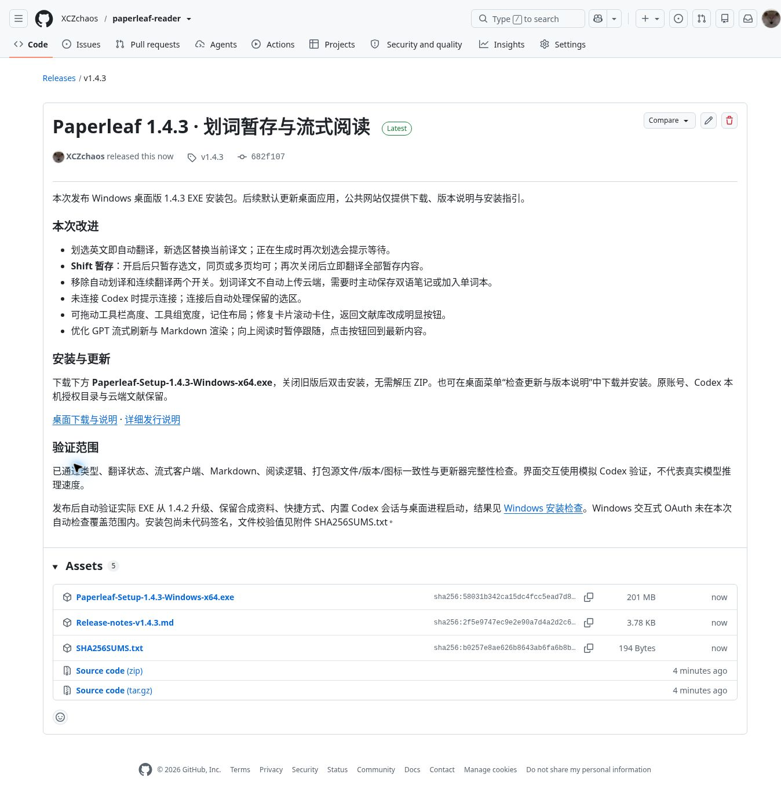

# Paperleaf 1.4.3 · 发布后验证

验证日期：2026-11-06。发布代码：`682f1079ea09d3a87091313baf594862e4554975`。

## 发行文件

- [GitHub Release](https://github.com/XCZchaos/paperleaf-reader/releases/tag/v1.4.3) 已正式发布，包含 EXE、发行说明与 SHA256SUMS.txt。
- `Paperleaf-Setup-1.4.3-Windows-x64.exe`：210468657 字节（200.7 MiB）。
- SHA-256：`58031b342ca15dc4fcc5ead7d8f2342e78171ad9d906266919077ba8184edac0`。GitHub 附件摘要与构建文件一致。
- EXE 解包后的全部 70 个程序文件与打包产物逐一校验一致。

## Windows 结果

- [Windows Codex compatibility](https://github.com/XCZchaos/paperleaf-reader/actions/runs/42179120108)：通过。
- [Windows released installer](https://github.com/XCZchaos/paperleaf-reader/actions/runs/42179484001)：通过。使用实际发布的 EXE 从 1.4.2 升级至 1.4.3，验证安装版本、合成资料保留、桌面和开始菜单快捷方式图标、内置 Codex 真实会话创建，以及桌面进程启动。

## 应用内更新服务

下载说明页与更新清单已发布。调用实际 `DesktopUpdater`，以 1.4.2 / Windows x64 客户端参数访问生产服务：检测到 1.4.3，下载全部 11 个更新分片，并通过完整 EXE 的 SHA-256 校验，状态到达 `ready`。该下载验证没有安装或执行 EXE。

## 覆盖边界

TypeScript、生产构建、翻译状态、流式客户端、Markdown、阅读逻辑、打包源文件和更新完整性检查通过。浏览器交互使用模拟模型；Windows 会话创建测试不等于真实账号问答。本次没有重测实际 GPT 推理速度、用户网络环境或交互式 OAuth。完整阅读界面测试见 [交互记录](web-2026-11-06.md)。

