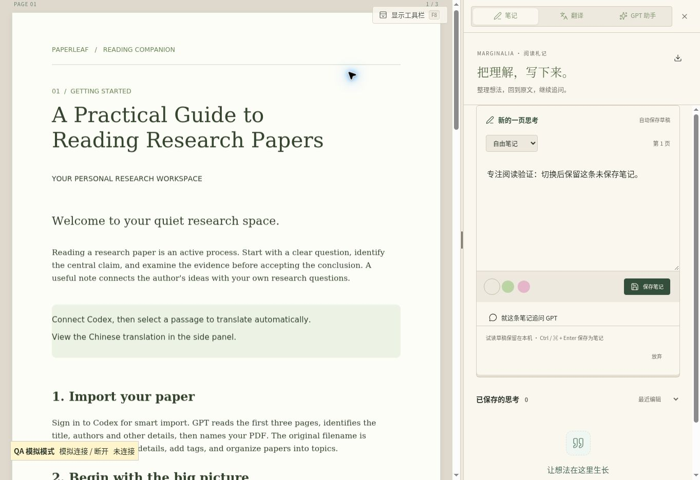

# Paperleaf 1.4.4 · 专注阅读

发布日期：2026-11-06。Windows 10 / 11 x64，Electron 45.2.2，Codex 0.165.0。

## 使用方式

点击阅读器的「专注阅读」，或按 **F8**，隐藏标题栏、目录、翻页缩放栏、批注工具栏与底栏。PDF 填满左侧阅读区的高度，右侧笔记、翻译和 GPT 助手继续可用。

右上角保留小型「显示工具栏」按钮，点击即可恢复；也可再次按 F8，或在论文阅读区按 Esc。编辑输入框和打开弹窗时，Esc 优先留给当前编辑或弹窗。Windows 菜单栏与阅读模式同步隐藏，Alt 可临时显示菜单，系统窗口标题栏和关闭按钮保留。

模式在当前设备记忆。切换保留当前阅读位置、侧栏宽度、原目录开关、笔记草稿及翻译会话。进入专注模式时切换为文字选择，避免工具栏不可见时误画；Ctrl + 滚轮缩放、空格拖动、方向键翻页、划词翻译和 Shift 暂存继续可用。



## 本次实现

- 仅收起阅读区固定控制元素，不卸载 PDF、笔记或翻译/GPT 组件。
- 用页面内的相对位置恢复滚动；等待目录收起后的宽度测量和 PDF 布局，避免宽度变化跳回页首。
- 窄 IPC 接口只接收专注状态；原有可信来源与主框架校验继续生效。原生菜单 F8 通过隔离的回调触发，移除监听后不再响应。
- 离开阅读器或重新导航时恢复原生菜单，旧版桌面没有新 IPC 时仍可使用页面按钮和键盘恢复。
- 桌面、连接程序、安装包、版本说明与更新清单统一为 1.4.4。公共网站继续只提供桌面下载与说明；阅读运行时仍使用原 HTTPS 来源和原云端数据。

## 已完成的本地验证

- TypeScript 类型检查、差异格式检查。
- 浏览器示例 PDF：点击专注、F8、Esc、悬浮按钮、刷新后模式记忆、横向和竖向阅读。
- 收起标题、工具栏、目录、分隔条与底栏后，测试视口中 PDF 阅读高度从 654 px 增加到 936 px，右侧宽度保持 460 px。
- 目录宽度变化测试：同一页相对纵向位置 0.665085 → 0.665160 → 0.665085，舍入误差不足 1 px；未跳回页首。
- 未保存笔记、翻译标签、Shift 暂存开关在切换前后保留。测试使用模拟连接，不调用真实 GPT，也不读写用户文献。
- 预加载接口来源限制、原生事件不暴露 Electron 事件对象、监听取消、窄 IPC 路由、账号隔离与退出清理。
- Windows 包内源文件、版本、图标、Codex 二进制的一致性；更新器版本比较、清单边界、SHA-256、篡改拒绝、取消和安装门禁。

发布后的 [Windows 安装检查](https://github.com/XCZchaos/paperleaf-reader/actions/workflows/windows-installer.yml) 下载本次实际 EXE，从 1.4.3 覆盖升级，验证合成资料保留、安装版本、快捷方式图标、内置 Codex 会话和桌面进程启动。请以对应 v1.4.4 运行结果为准。

Windows 交互式 OAuth、真实账号推理和原生菜单的人工视觉验收不在本次自动化范围。安装包尚未代码签名。

## 安装

[下载 Windows EXE](https://github.com/XCZchaos/paperleaf-reader/releases/download/v1.4.4/Paperleaf-Setup-1.4.4-Windows-x64.exe)，关闭旧版后双击安装，无需解压 ZIP。也可在桌面「版本与更新」中检查新版、查看说明、下载并退出安装。账号资料和云端文献保留。

[下载页面](https://paperleaf-xcz-reader.shamboo2003.chatgpt.site/) · [GitHub Release](https://github.com/XCZchaos/paperleaf-reader/releases/tag/v1.4.4)

安装包：210,573,252 字节（200.8 MiB）。SHA-256：

```text
f3f7b21a607dce4717d0bbe8e1daf3f023d11a6378ede19aed10181c7b3bf5c7
```

解压本次 EXE 后，全部 70 个程序文件与打包目录逐一校验一致。
