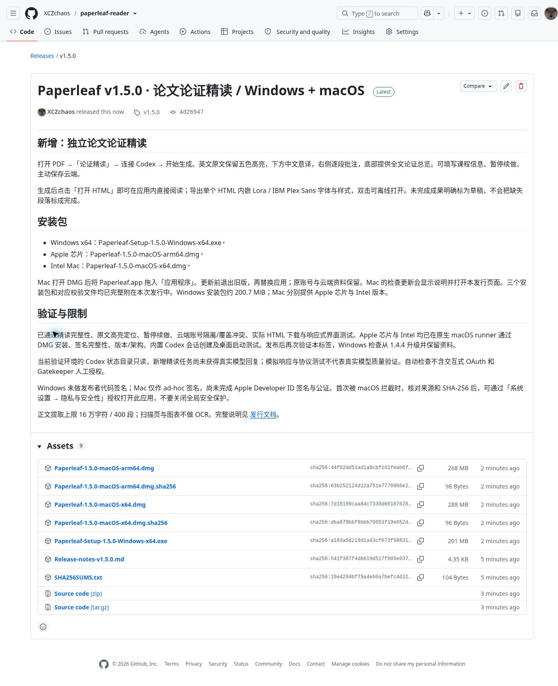

# Paperleaf 1.5.0 · 论文论证精读与 macOS

发布日期：2026-11-18。桌面版更新；公共网站仍提供安装包、版本说明和指引，阅读界面由桌面客户端从原 HTTPS 来源加载。

## 使用入口

打开文献 → 顶部「论证精读」→ 可选填写课程 → 检查正文提取范围 → 连接 Codex → 开始全文精读。完成后点击「打开 HTML」在应用内直接阅读，点击「导出完整 HTML」保存单个离线文件。

- 左栏按段保留英文原文与中文意译，右栏逐段说明段落功能、逻辑角色、论证技巧或潜在漏洞。
- 黄色核心论点、红色概念、蓝色证据、绿色让步/反驳、紫色方法；只有英文高亮。中文采用 #f0ece2 背景与左侧细线。
- 深海军蓝导航、米白纸页、Lora 正文、IBM Plex Sans 界面；章节栏固定，可跳回段落。窄屏自动单栏。
- 末尾整理问题、论点、证据、反驳、结论，一句话核心主张及最强/最弱处，引用可跳转。
- 每批完成后自动保存在当前账号的本机记录，暂停后从未完成批次继续。云端必须主动保存；同一文献跨设备修改通过 ETag 检测冲突。
- 导出内嵌字体、完整许可证与样式，无脚本、无外部字体请求。草稿明确标注未完成，并保留缺失段落占位。

## 安装包

- Windows x64：`Paperleaf-Setup-1.5.0-Windows-x64.exe`。支持检查更新、校验下载、退出安装及保留原账号资料。
- Apple 芯片：`Paperleaf-1.5.0-macOS-arm64.dmg`。
- Intel Mac：`Paperleaf-1.5.0-macOS-x64.dmg`。
- Mac 打开 DMG，把 Paperleaf.app 拖入「应用程序」。更新前退出旧版，再替换应用；更新菜单显示版本说明并打开官方 Release。
- Windows 尚未做发布者签名。Mac 仅作 ad-hoc 签名，未完成 Developer ID 签名及 Apple 公证。确认官方来源和 SHA-256 后，可在「系统设置 → 隐私与安全性」中授权本应用；不要关闭全局安全保护。
- 校验值随 Release 提供；Windows 更新分片另有逐片和整包 SHA-256 校验。Electron 45.2.2，Codex 0.165.0。

## 验证范围

- `check-argument.mjs`：真实桥接代码配合显式模拟 RPC，验证请求结构、返回结构、英文保真、高亮定位、段落无遗漏/重复、来源引用、HTML 转义和嵌入字体；21 段分批暂停续做，已完成批次不重复请求。
- `node --experimental-vm-modules scripts/check-api.mjs`：身份验证、文献所有权隔离、云端精读读写、条件写入、并发冲突和删除清理；已有账号/PDF/笔记/翻译测试继续通过。
- `tsc --noEmit`、连接程序、划词状态、流式处理和更新校验回归。
- 浏览器交互：在独立精读工作区生成合成文献，打开 HTML、章节和论证来源跳转、实际下载单文件、关闭重开恢复、390px 单栏与无横向溢出。截图均为合成样例，非用户论文。
- 原生 Mac 预发行验证：[Apple 芯片与 Intel 的构建和安装测试](https://github.com/XCZchaos/paperleaf-reader/actions/runs/44271950313)。测试挂载 DMG、复制安装、程序架构、品牌图标、版本、ad-hoc 签名、源码字节一致性、SHA-256、内置 Codex 创建真实会话及桌面进程启动。
- 先将两个原生验证通过的 Mac DMG 和完整校验过的 Windows EXE 上传到草稿，核对附件齐全后发布。发布后再次检查 release 标签，已发布的 Mac 安装包不会被重复构建覆盖。Windows 发布检查验证从 1.4.4 安装升级、资料保留、快捷方式图标、内置 Codex 会话及进程启动。

**真实模型验证限制：** 当前验证环境的 Codex 状态目录只读，新增精读任务未拿到真实模型回复。模拟响应、协议会话创建和进程启动不等同于真实模型质量验证。自动测试也不包含交互式 OAuth 或 macOS Gatekeeper 人工授权。应用 Codex 面板保留「测试 GPT」，可在实际账户网络下检查连接。

## 内容边界

分析范围默认正文（含摘要），可切换全部可提取文字。扫描页、图片和图表不做 OCR；复杂版面仍需核对提取原文。每篇最多 16 万字符 / 400 段，超出时在模型请求前提示拆分，不默默截断。模型只标注原文实际片段；对不存在或交叠的高亮不绘制并记录提示。批注和译文由 GPT 生成，重要判断请核对原文。

HTML 导出可独立离线阅读；桌面程序的云端文献与生成任务仍需联网。

## 已发布文件与核验记录

[正式发行 v1.5.0](https://github.com/XCZchaos/paperleaf-reader/releases/tag/v1.5.0) 包含以下三个安装包及校验文件。

| 平台 | 大小 | SHA-256 |
| --- | ---: | --- |
| Windows x64 EXE | 200.7 MiB | `a183a5d218d1a43cf073f58831187d6a702bb1a305de287f499e08cca96cb5ee` |
| macOS Apple 芯片 DMG | 267.8 MiB | `44f02dd51ad1a8cbf101feab6fcb6ab800510eb40e8de7a16367cf98673cffde` |
| macOS Intel DMG | 288.4 MiB | `7d18199caa84c7330d66187620033bf0aa820959a4ada4a8b0981ddc3790a670` |

- [发布前 Mac 原生安装与 Codex 测试](https://github.com/XCZchaos/paperleaf-reader/actions/runs/44273681904)。
- [仅向草稿上传已验证安装包](https://github.com/XCZchaos/paperleaf-reader/actions/runs/44274474909)：校验两个 DMG、核对原生源码一致性、从正式更新源下载并校验 EXE，保持草稿状态直到全部附件齐全。
- [Windows 已发行安装包验证](https://github.com/XCZchaos/paperleaf-reader/actions/runs/44274823099)：1.4.4 → 1.5.0 升级成功，合成用户资料标记保留，版本/图标/内置 Codex/桌面启动检查通过。
- [release 标签的 Mac 原生检查](https://github.com/XCZchaos/paperleaf-reader/actions/runs/44274822994)。
- 正式更新服务器已完整下载 210,483,313 字节 EXE，逐片和整包 SHA-256 与 GitHub 发行资产一致。

