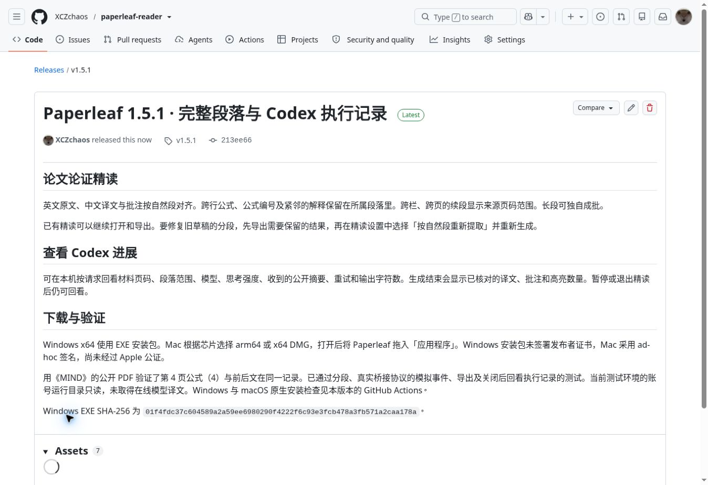

# Paperleaf 1.5.1

## 精读与段落

打开论文的「论证精读」。英文原文、译文和逻辑批注按自然段对应。公式的引导句、可提取的公式字符、编号和相邻的变量说明一起送入同一批次。跨页续段标出来源页码范围。长段会独自成批。图像或 PDF 绘图指令里的符号仍需对照原始页面。

旧版精读保留原有内容。要修复旧草稿，先导出需要保留的 HTML，再在「精读设置」中点「按自然段重新提取」，确认后重新生成。覆盖云端版本需单独点击「保存到云端」。

## 查看 Codex 进展

展开「查看 Codex 进展」可跟随最新请求，也可回看指定批次或总览。每次请求会显示来源页码、段落范围、模型与思考强度。收到对应事件时，时间线显示公开计划与说明、重试、结构化结果已接收的字符数，以及最终核对的段落和高亮数量。模型提供公开摘要时，会显示在时间线下方。

执行记录保存在当前账号的本机缓存，可在暂停、完成或重开精读后查看。每份精读最多保留最近 120 次请求。

## 安装包

| 平台 | 下载 | SHA-256 |
| --- | --- | --- |
| Windows x64 | [EXE](https://github.com/XCZchaos/paperleaf-reader/releases/download/v1.5.1/Paperleaf-Setup-1.5.1-Windows-x64.exe) | `01f4fdc37c604589a2a59ee6980290f4222f6c93e3fcb478a3fb571a2caa178a` |
| Mac Apple 芯片 | [DMG](https://github.com/XCZchaos/paperleaf-reader/releases/download/v1.5.1/Paperleaf-1.5.1-macOS-arm64.dmg) | `13439b55fa2b0986cbaa084d1c6d1de13f2572eddf10da234b3c04707734501d` |
| Mac Intel | [DMG](https://github.com/XCZchaos/paperleaf-reader/releases/download/v1.5.1/Paperleaf-1.5.1-macOS-x64.dmg) | `eef7d2709486bf3dc72e48268320e7848c80aae184d27e29cb56376eae50f65b` |

Windows 安装包未做发布者签名。macOS 使用 ad-hoc 签名，尚未完成 Apple 公证。

## 验证

- 在《MIND》的 15 页公开 PDF 上复现并回归检查第 4 页公式（4）。重建后的一个原文段落依次包含损失函数定义、求和、编号和采样说明，后面的 4.2 节另起。可用 `node scripts/check-argument-paragraphs.mjs <PDF路径>` 复核。[论文](https://arxiv.org/abs/2502.02607)
- 合成段落覆盖跨页续写、跨栏续句、扫描页间隔、列表、标题及超过普通批次长度的自然段。桌面界面用合成响应完成了两次请求，并验证关闭、重新打开后仍可选择上一批。
- 内置 Codex 的事件映射通过协议测试。真实账号的运行状态目录在本次测试环境中只读，未取得该版本的在线模型译文。
- 原生安装和启动检查可在对应工作流查看。[Windows](https://github.com/XCZchaos/paperleaf-reader/actions/runs/44284641941) · [Apple 芯片与 Intel](https://github.com/XCZchaos/paperleaf-reader/actions/runs/44281247908) · [安装包校验](https://github.com/XCZchaos/paperleaf-reader/actions/runs/44284322109)

