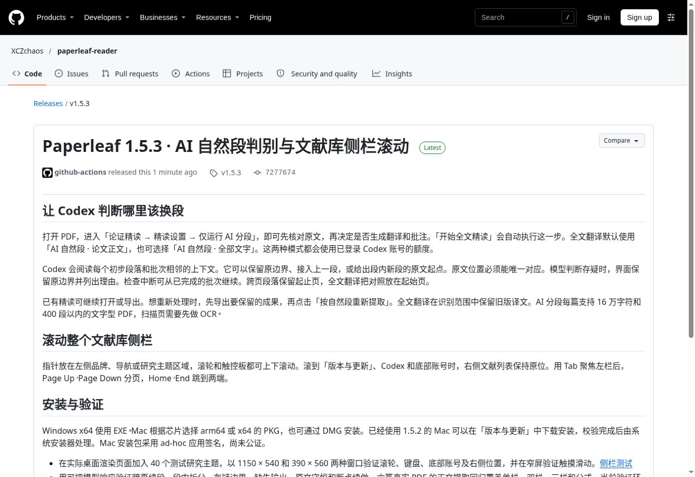

# Paperleaf 1.5.3 · AI 自然段判别与文献库侧栏滚动

## 让 Codex 判断哪里该换段

打开 PDF，进入「论证精读 → 精读设置 → 仅运行 AI 分段」，即可先核对原文，再决定是否生成翻译和批注。「开始全文精读」会自动执行这一步。全文翻译默认使用「AI 自然段 · 论文正文」，也可选择「AI 自然段 · 全部文字」。这两种模式都会使用已登录 Codex 账号的额度。

Codex 会阅读每个初步段落和批次相邻的上下文。它可以保留原边界、接入上一段，或给出段内新段的原文起点。原文位置必须能唯一对应。模型判断存疑时，界面保留原边界并列出理由。检查中断可从已完成的批次继续。跨页段落保留起止页，全文翻译把对照放在起始页。

已有精读可继续打开或导出。想重新处理时，先导出要保留的成果，再点击「按自然段重新提取」。全文翻译在识别范围中保留旧版译文。AI 分段每篇支持 16 万字符和 400 段以内的文字型 PDF，扫描页需要先做 OCR。

## 滚动整个文献库侧栏

指针放在左侧品牌、导航或研究主题区域，滚轮和触控板都可上下滚动。滚到「版本与更新」、Codex 和底部账号时，右侧文献列表保持原位。用 Tab 聚焦左栏后，Page Up、Page Down 分页，Home、End 跳到两端。

## 安装与验证

Windows x64 使用 EXE。Mac 根据芯片选择 arm64 或 x64 的 PKG，也可通过 DMG 安装。已经使用 1.5.2 的 Mac 可以在「版本与更新」中下载安装，校验完成后由系统安装器处理。Mac 安装包采用 ad-hoc 应用签名，尚未公证。

- 在实际桌面渲染页面加入 40 个测试研究主题，以 1150 × 540 和 390 × 560 两种窗口验证滚轮、键盘、底部账号及右侧位置，并在窄屏验证触摸滑动。[侧栏测试](https://github.com/XCZchaos/paperleaf-reader/actions/runs/44474750743)
- 用可控模型响应验证跨页续段、段内拆分、存疑边界、缺失输出、原文守恒和断点续做。六篇真实 PDF 的正文提取回归覆盖单栏、双栏、三栏和公式。当前验证环境的账号运行目录为只读，在线 Codex 未能完成新分段任务。可以在已登录的桌面客户端直接使用「仅运行 AI 分段」查看实际判断。[分段与版式回归](https://github.com/XCZchaos/paperleaf-reader/actions/runs/44474313842)
- Apple 芯片和 Intel 两种机型都在原生 macOS runner 上用系统安装器从 1.5.2 升到 1.5.3，校验本机测试资料、应用启动及内置 Codex 线程。[Mac 安装记录](https://github.com/XCZchaos/paperleaf-reader/actions/runs/44472672113)

- Windows 安装检查从已发布的 1.5.2 EXE 升级，核对本机资料、快捷方式、内置 Codex 与桌面启动。[Windows 安装记录](https://github.com/XCZchaos/paperleaf-reader/actions/runs/44475389738)

[桌面下载页](https://paperleaf-xcz-reader.shamboo2003.chatgpt.site/desktop)

