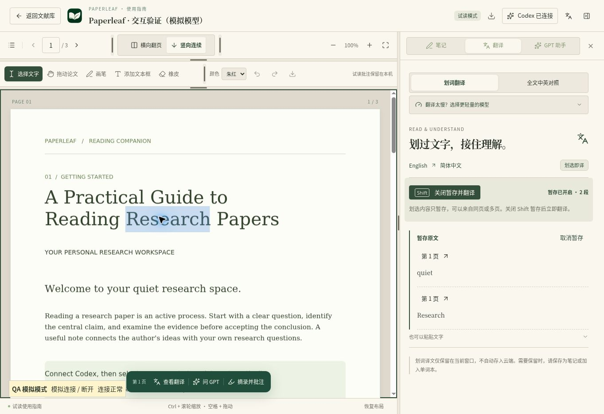

# 2026-11-06 · 划词暂存、布局调整与流式阅读

本记录描述桌面阅读界面的实现与验证。原先的托管界面更新已纳入 **1.4.3 桌面发行版**；公共网页入口调整为安装包与版本说明，阅读工作台仅由桌面客户端进入。安装包与更新清单见 [1.4.3 发行说明](v1.4.3.md)。

## 行为变化

- 划选 PDF 文字即自动打开翻译区并翻译。新的选区替换当前临时结果；正在翻译时再次划选，弹出等待提示，不取消任务、不加入队列。
- Shift 是暂存开关：开启后只积累选文，可以来自同一页或多页。再次点按关闭后立即发起一次翻译，并携带实际涉及页面的上下文。忽略输入框、对话框、快捷键组合和按键重复；也可点击侧栏按钮操作。
- 暂存内容、选区与本次译文只驻留在窗口内存，不自动写云端，也不自动收录单词。明确点击保存双语笔记或加入单词本才持久化。移除旧的自动划译、连续翻译开关、自动队列和自动保存历史。旧版遗留本机翻译缓存不会在退出账号时补传；不删除已有云端成果。全文翻译的云端段落任务保持原行为。
- 没有 Codex 连接时给出提示和连接入口，保留最新选区；检测到登录完成后自动开始处理。
- 阅读工具栏和批注栏的横线可调整高度；页码区、阅读方式区和批注工具区的竖线可调整宽度。与两侧栏相同，支持鼠标/触控拖动、方向键、双击复位；尺寸保存在当前设备，可一键恢复布局。
- 明确的返回文献库按钮；翻译区采用复古纸页、留白、层次化来源与轻量状态动效，尊重减少动态效果偏好。
- 阅读卡片的内部滚动允许传递到外层，避免滚动到卡片边缘后停住；进度与原文卡片减少嵌套纵向滚动。

## 流式输出

保持现有 Codex HTTP 流式上游与桌面 IPC 协议。前端获取任务状态改为串行自适应轮询：有输出时约 220 ms，无新内容时 550 ms，重试等待或后台窗口降频；不会创建并发轮询。相同响应不重复触发渲染，最终结果完整保留。Markdown 使用可延后渲染，让输入和滚动优先；取消时屏蔽迟到的 IPC 响应并只发送一次取消。

自动跟随以实际滚动容器为准：在底部阅读时跟随新内容，向上查看旧内容时暂停；提供回到最新内容入口。这里只优化前端交付和渲染，不承诺缩短模型自身推理时间。

## 验证

- TypeScript 编译检查。
- `check-selection.mjs`：等待连接、最新选区替换、单任务保护、Shift 暂存开关、同页/多页来源、重复片段与长度限制、过期结果隔离。
- `check-stream.mjs`：部分输出、无变化响应去重、最终文本一致性、顺序轮询、取消与迟到 IPC 竞态；旧翻译缓存不自动补传，草稿和批注仍可同步。
- `check-markdown.mjs`、`check-reading.mjs`：格式化文本、引用与公式、未完成文本渲染、上下文、正文识别与批注几何回归。
- 浏览器使用临时的模拟 Codex 与公开使用指南测试真实 Reader/Translation 组件，验证连接提示、自动开始、忙碌提示、替换、跨页暂存、工具栏拖动/键盘调整/刷新记忆及恢复布局。模拟界面不会发布。
- 浏览器流式滚动实测：译文由 306 字符增长到 436 字符时，向上阅读的位置保持不变；点击“查看最新译文”后，在继续输出时回到底部。
- 更新使用指南 PDF 并逐页检查排版。

此处的浏览器测试不覆盖 Windows 安装、官方 OAuth 或真实模型速度；本次 Windows 安装结果另见 1.4.3 发行说明。之前版本的真实模型记录不能代表本次用户网络表现。用户指定 Windows 目录下的 impeccable 技能未能在当前环境读取，因此不声称已按该技能完成优化。
